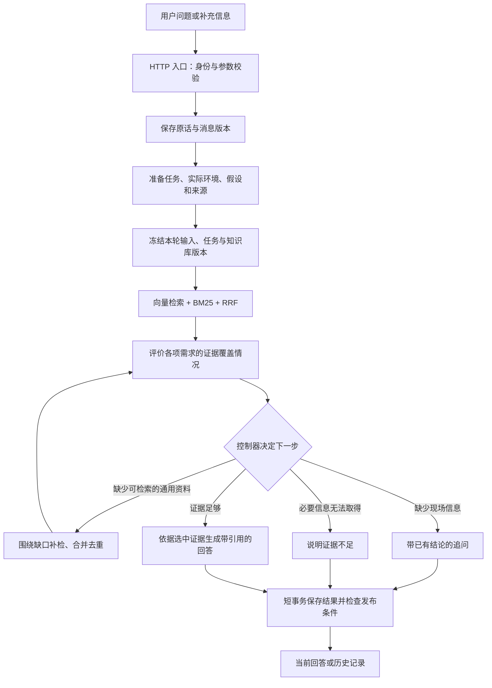

# 部署排错 RAG 助手

**周曜宇 · AI 应用作品案例**

北京邮电大学数学硕士在读｜Python · FastAPI · PostgreSQL · RAG · 多轮会话

帮助正在学习部署与数据库的开发者，结合官方资料和自己的运行环境，理解“为什么出错、接下来应检查什么”。系统保留多轮排查任务，区分实际环境与假设方案，在证据不足时补充检索或追问，避免直接给出未经证实的故障结论。

**阅读入口：** [本人负责的部分与问题复盘](docs/case-study.md) · [五轮真实对话记录](evidence/multiturn-dialogue.md) · [架构与源码导航](docs/architecture.md) · [本地运行](docs/run.md)

这是个人学习场景中的应用原型，包含可运行源码、固定语料、测试与已有验证记录。尚未用于学校课堂或真实教学服务；面向教育场景的应用设想见案例文档。

## 我负责了什么

| 工作 | 具体贡献 | 可查看的依据 |
| --- | --- | --- |
| 场景与需求拆解 | 将“连接失败怎么办”拆成环境信息、通用规则和现场证据；区分可回答、需要追问和证据不足 | [问题与验收要点](data/evaluations/current_version_20261105/single_turn_cases.json) |
| 多轮会话设计 | 参与设计实际环境、假设条件和原话来源分开保存；纠正时更新变化字段，保留未变化的服务名与端口 | [E05 五轮记录](evidence/multiturn-dialogue.md)、[本人设计示例](evidence/case-records.json) |
| 检索与回答分析 | 判断问题发生在召回、选证还是生成阶段；参与分析“重新选中已有证据”和“补检”各自的贡献 | [CP01 分析记录](evidence/contribution-analysis-CP01.json) |
| 验证与边界整理 | 参与制定预期行为，检查回答与保存状态，分析耗时和调用次数，记录未解决问题 | [开发样本复核](evidence/paired-review-20261105.json)、[多轮复核](evidence/multiturn-review-20261105.json) |

开发过程中使用 AI 辅助编程、测试脚本编写和部分逐题复核。我的贡献重点是需求与场景设计、关键方案讨论、验收判断和结果分析，不将全部代码表述为独立手写，也不把 AI 复核称为人工独立标注。

## 一个能看见设计价值的例子

用户先询问宿主机如何连接 Compose 中的数据库，随后讨论迁移方案，又切回实际环境，最后确认已迁移。难点在于：**同一段对话里，实际情况与假设条件会变化，历史答案不能直接变成新的事实。**

| 轮次 | 用户表达 | 应保存的状态与回答 |
| --- | --- | --- |
| M1 | 应用在宿主机；服务名 `db`；映射 `5433:5432` | 实际应用位置为宿主机；连接 `localhost:5433` |
| M2 | “我暂时还没迁移。如果以后放入同一个 Compose 网络……” | 实际环境仍为宿主机；仅在假设下建议 `db:5432` |
| M3 | “只分析刚才的假设场景” | 继承 M2 的假设及来源，继续给出条件性排查建议 |
| M4 | “回到当前实际部署” | 回到 `localhost:5433`，不把假设写成实际迁移 |
| M5 | “现在已经按那个方案完成迁移” | 更新用户陈述的实际环境，保留服务名与端口映射，建议 `db:5432` |

这里同时核对**输出回答与数据库中的会话状态**，而非只检查回复是否通顺。[查看保存的用户原话、回答和状态](evidence/multiturn-dialogue.md)。用户说已迁移，不等于系统已远程验证网络连通。

## 从输入到回答



- **混合检索：** 向量检索匹配语义，BM25 匹配关键词，RRF 融合各路排名。当前语料规模较小，使用精确余弦检索；没有宣称部署大规模 ANN 索引。
- **覆盖评价：** 把问题拆成需求，检查每项对应的证据；相关性高不代表关键点齐全。模型提出建议，控制器执行并限制流程。
- **会话与版本：** 一次运行固定输入、任务和语料版本。新消息到来后，旧运行的迟到结果可以保留为历史，但不能覆盖当前答案。
- **可追溯：** 保存原话来源、候选证据、评价结果、调用记录与终态，支持按环节排查。

## 做过什么验证，结果说明什么

### 选证对比：TX02

问题是：SQLAlchemy 连接已经成功 `commit()`，没有新 SQL 或新事务，再调用一次 `commit()` 会怎样？关键接口规则排在初检候选的第 5 位。

| 同一问题、初始候选与语料版本 | A：RRF 前 3 条直接生成 | B：先评价覆盖情况再选证 |
| --- | --- | --- |
| 最终选中初检排名 | 1、2、3 | 2、5 |
| 输出 | 能说明事务结束，但缺乏确认无活动事务时行为的直接依据 | 依据接口规则说明该条件下为 no-op |
| 额外补检 | 0 次 | 0 次 |
| 生成／评价模型请求合计 | 1 次 | 2 次 |
| 本次记录的流程耗时 | 9.06 秒 | 25.51 秒 |

**这题支持“覆盖评价帮助选回关键证据”，不证明补检有效，更不代表所有问题都值得增加模型调用。** 它也展示了质量与延迟的取舍。[查看记录及原始计时](evidence/case-records.json)。该 A/B 比较的是整条覆盖处理流程；若单独归因补检，需要固定评价与选证策略再做消融。

### 验证范围

| 范围 | 已有记录 | 能支持的结论 |
| --- | --- | --- |
| 固定语料 | 53 个正文片段，含来源与版本信息 | 本次实验使用可核对的固定资料 |
| 单轮开发集 | 15 道问题、A/B 共 30 次执行 | 可分析具体回答缺口和流程差异 |
| 多轮开发集 | 10 个场景、30 轮、118 项状态／来源／回放检查通过 | 已覆盖这些固定场景的状态行为 |
| 历史 PostgreSQL／HTTP 隔离测试 | 90 项通过 | 已检验对应持久化、隔离与恢复行为 |
| 本次公开版本离线测试 | 297 项通过，212 项子测试通过；90 项数据库测试跳过 | 导出后的源码及固定资料可在本地进行离线检查 |

历史模型验证日期为 **2026-11-05**，公开整理日期为 **2026-11-12**。历史离线记录与当前导出子集口径不同，分别保留；本次未重新调用模型。开发集已知且部分复核由 AI 辅助完成，**不据此宣称生产准确率或独立留出集成绩**。

[历史验证摘要](evidence/historical-closeout.json) · [公开版本检查结果](evidence/export-verification.json) · [验证材料索引](evidence/README.md)

## 下载后如何查看

无需 API Key 或数据库即可展示保存的案例并核验固定资料：

```bash
git clone https://github.com/2625776299-commits/deployment-rag-assistant.git
cd deployment-rag-assistant
python scripts/show_recorded_case.py
python scripts/check_artifacts.py
```

运行离线测试（已验证环境：Python 3.13）：

```bash
python -m venv .venv
# Windows PowerShell: .\.venv\Scripts\Activate.ps1
# macOS / Linux: source .venv/bin/activate
python -m pip install -r requirements-dev.txt
python -m pytest tests -q
```

要体验真实多轮 HTTP 请求，按[运行说明](docs/run.md)配置本地 PostgreSQL 与模型凭据，再启动 `python -m app.conversation_runtime`。查看记录与真实运行是两个不同入口，前者不会调用模型。

## 当前边界与后续方向

- TX01“提交确认丢失与安全重试”仍有关键资料召回缺口，当前明确返回证据不足；没有将失败样本从记录中隐藏。
- 引用存在、格式合法，不代表模型一定正确理解事实；仍需要语义分析和多种表述测试。
- 额外评价、补检会增加耗时；目前没有大规模用户数据或稳定性能指标。
- 本地 Token 演示鉴权不等同于完整生产账号系统，项目也没有代替用户自动修改部署。
- 面向教育，可延伸为编程实验答疑助手，但还需课程资料、教师审校与真实学习者验证。

源码与材料的来源、公开范围见[来源说明](THIRD_PARTY_NOTICES.md)。本仓库是已有学习项目的公开快照，提交日期不代表原开发起始日期。
